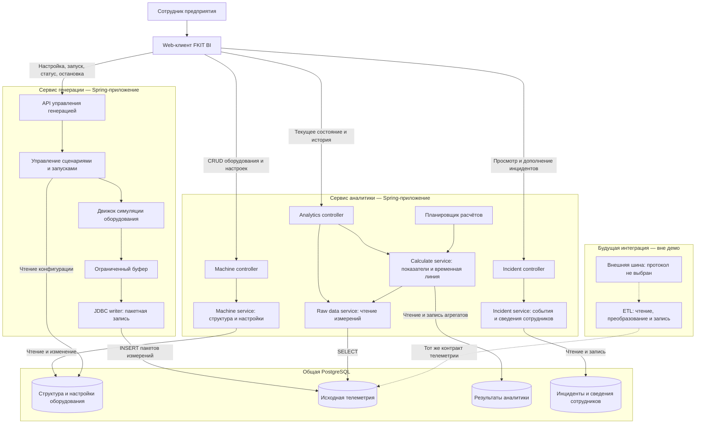
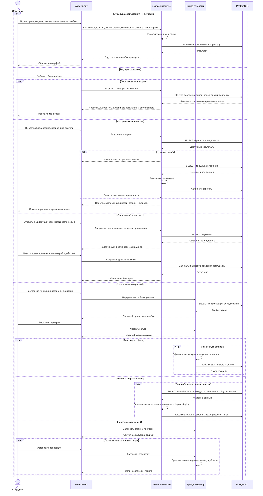
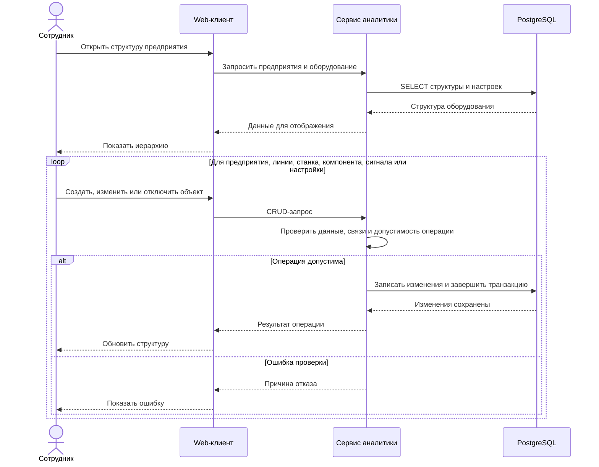
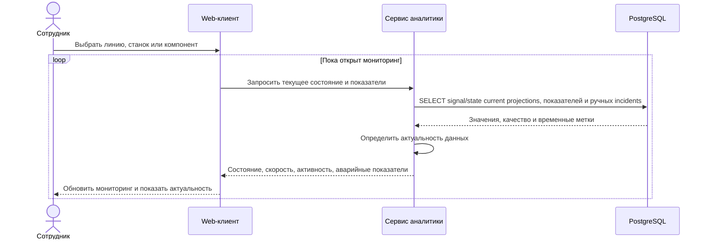
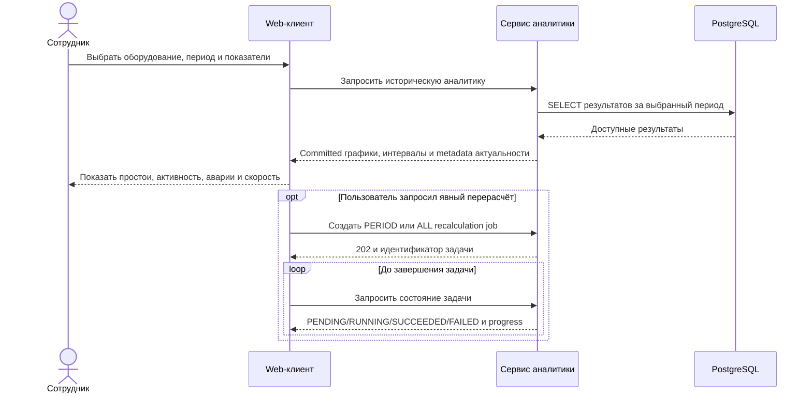
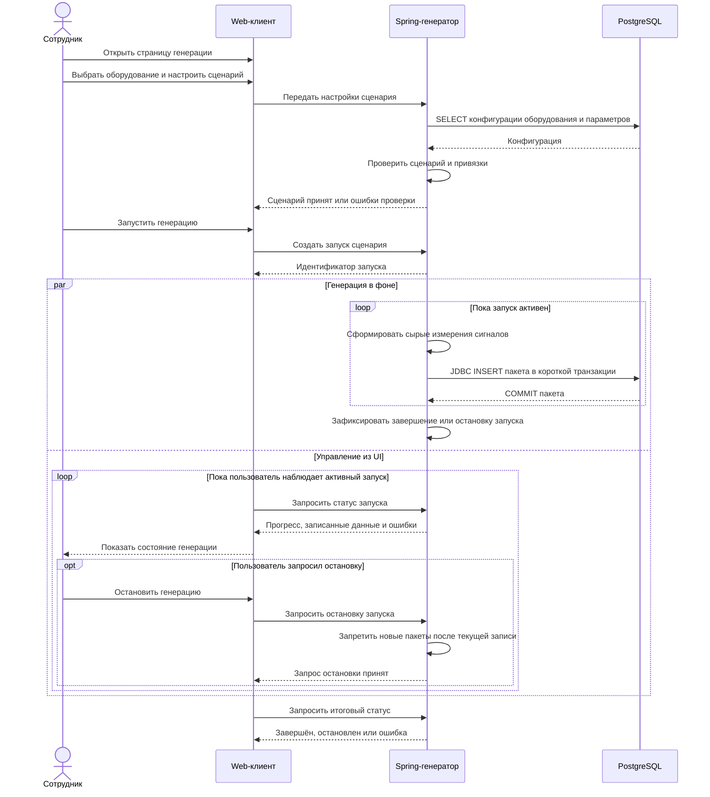
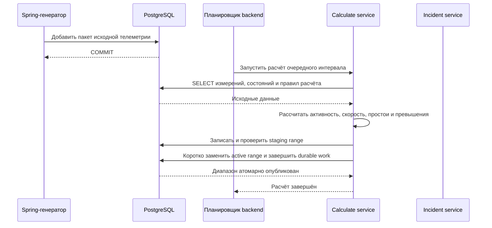

# FKIT BI — архитектура демонстрационной версии

Согласованная основа MVP: веб-клиент, отдельные Spring-приложения Analytics и Generator, одна общая PostgreSQL и обязательные Prometheus/Grafana с exporters. Внутри каждого приложения функциональность разделяется на модули; это не набор микросервисов. Генератор пакетно добавляет raw measurements через JDBC-контракт. Analytics непрерывно обновляет read projections фоновыми workers, а HTTP синхронно читает последнюю committed проекцию. Создание инцидентов в MVP ручное; автоматическая классификация инцидентов, ETL и внешняя шина отложены. Канонические модели и контракты находятся в `docs/bmad/specs/` и `docs/contracts/`.

## Компоненты системы

Вложенные блоки — модули соответствующего приложения, а не отдельные микросервисы. Четыре области хранения находятся в одной PostgreSQL. Стрелки к базе обозначают выполняемые запросы. Пунктир обозначает будущую интеграцию.



| Область | Ответственность |
| --- | --- |
| Структура оборудования | Предприятие владеет линиями и станками; свободный станок можно однократно назначить линии. Станок владеет деревом компонентов, где датчики, приборы и инструменты являются видами компонента; сигнал принадлежит станку и может ссылаться на его компонент. CRUD выполняет основной backend. |
| Телеметрия | Генератор добавляет исходные измерения сигналов. Backend читает их и не изменяет при расчётах. |
| Аналитика | Текущее состояние, скорость, активность, всплески, аварийные показатели, интервалы простоя и исторические агрегаты. Расчёты выполняет backend. |
| Инциденты | Созданные сотрудниками ручные инциденты/причины и их lifecycle. Автоматическое обнаружение/классификация инцидентов не входит в MVP; ручные сведения хранятся отдельно от исходных измерений. |
| Генерация | Отдельный раздел web-клиента управляет сценариями и запусками через API генератора. |

## Общая последовательность всех пользовательских сценариев

Ветви `alt` обозначают разные действия пользователя. Генерация и фоновая аналитика работают независимо. Детальные последовательности приведены ниже.



## 1. Управление структурой оборудования и настройками

Одна последовательность применяется ко всем CRUD-операциям. В предприятии создают линии и отключённые станки; станок можно сразу или позднее однократно назначить линии, после чего добавляют дерево компонентов разных видов, сигналы и настройки. Физическое удаление конфигурационных сущностей в MVP не выполняется.



## 2. Просмотр текущего состояния оборудования

Для демо используется периодический опрос только current read models. Это обновление с небольшой задержкой, а не гарантия жёсткого реального времени. Ответ содержит время измерений, `dataThrough`, время расчёта, `stale` и `recalculating`, чтобы UI отличал свежие значения от устаревших.



## 3. Историческая аналитика и временная линия

Включает выбор периода, просмотр простоев, всплесков активности, аварий и скорости. HTTP-чтение всегда возвращает последнюю полную committed projection и никогда не запускает расчёт. Пользователь отдельно создаёт asynchronous recalculation job только после изменения правил или по явной команде пересчитать период либо всю историю.



## 4. Внесение сотрудником сведений об инциденте

Сотрудник может дополнить существующую аналитическую временную линию причиной или зарегистрировать инцидент вручную. Автоматически обнаруживаемых инцидентов в MVP нет. Ручная запись описывает факт и не переписывает исходную телеметрию.

```mermaid
sequenceDiagram
    actor U as Сотрудник
    participant W as Web-клиент
    participant B as Сервис аналитики
    participant D as PostgreSQL
    U->>W: Открыть инцидент или зарегистрировать новый
    opt Открыт существующий инцидент
        W->>B: Запросить сведения об инциденте
        B->>D: SELECT события и ручных сведений
        D-->>B: Карточка инцидента
        B-->>W: Сведения для формы
    end
    U->>W: Указать время, SETUP/PLANNED_STOP, причину и комментарий
    W->>B: Создать, изменить, закрыть или отменить инцидент
    B->>B: Проверить границы, ownership, overlap и eligibility
    B->>D: Сохранить сведения, автора и время изменения
    D-->>B: Сведения сохранены
    B-->>W: Обновлённая карточка; аналитика пересчитывается асинхронно
    W-->>U: Показать результат и связь с временной линией
```

## 5. Настройка, запуск, статус и остановка генерации

Предусловие: структура оборудования, компоненты и сигналы уже созданы через Analytics API. Scenario, GenerationRun, immutable snapshot, progress и terminal result сохраняются в общей PostgreSQL; генератор не дублирует CRUD оборудования и пишет raw только по существующим `signalId`.



## 6. Фоновая обработка новых измерений

Планировщик и calculation workers работают внутри приложения Analytics. Обработка идёт независимо от HTTP-запросов и Generator. Durable work задаёт ограниченные event-time окна; пересчёт и staging выполняются вне короткой публикационной транзакции. Затронутый диапазон заменяется атомарно, поэтому чтения получают прежнюю полную либо новую полную committed проекцию. Late-data boundaries и evaluator context определены в `spec-machine-state-projections/` и `spec-raw-telemetry-ingestion/`.



## Границы ответственности

- Генератор пишет исходные измерения; Analytics читает их и пишет структуру, производные проекции и ручные сведения об инцидентах. Расчёт сам по себе не создаёт инциденты.
- Оба приложения используют один согласованный контракт таблиц и согласованные миграции. Проверки телеметрии выполняет писатель; ограничения целостности обеспечивает база.
- Генерация и расчёты выполняются в фоне. HTTP-запуск генерации не держит запрос открытым на весь сценарий.
- Для исходной телеметрии используются короткие пакетные транзакции и защита от повторной записи. JDBC или R2DBC сами по себе не устраняют дедлоки.
- Номинальный профиль, пределы нагрузки, SLO и минимальный стенд определены в `docs/bmad/specs/spec-mvp-load-slo/`; observability и его запуск — в `docs/bmad/specs/spec-observability-runtime/`.
- Сценарии прогнозирования, подключение реальной шины и ETL не входят в текущую демо-версию.
