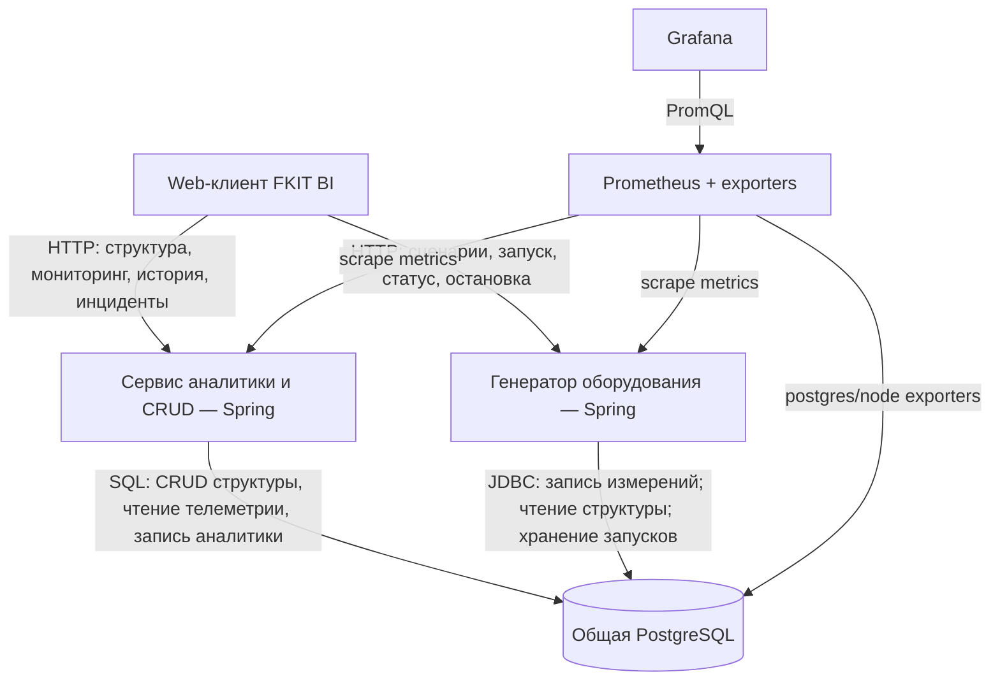
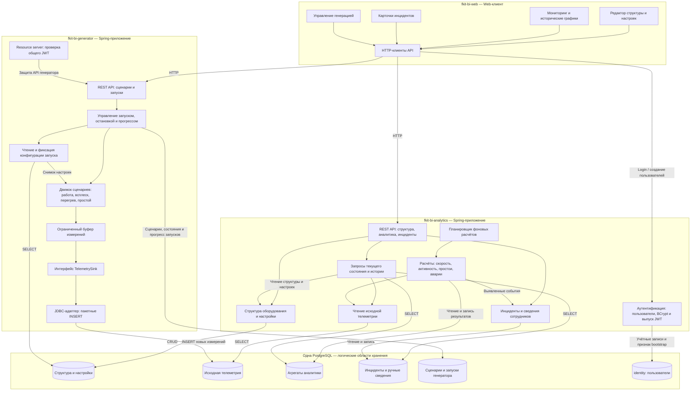

# FKIT BI: компоненты демо и границы репозиториев

Архитектура MVP: два отдельных модульных Spring-приложения (Analytics и Generator), Web-клиент, одна PostgreSQL и обязательный лёгкий observability stack. Генератор пакетно пишет raw measurements напрямую через JDBC; Analytics непрерывно строит read projections, которые HTTP API синхронно отдаёт без расчёта на запросе. Kafka и ETL отложены. Подробные контракты и данные — в `docs/bmad/specs/`.

## 1. Уровень сервисов

Стрелки показывают направление запросов и операций. База возвращает результаты чтения.

Аналитика и генератор запускаются независимо. Между ними нет обязательных HTTP-вызовов. Web обращается к API обоих приложений; для демо обновляет мониторинг периодическим опросом. PostgreSQL — общий ресурс, но права записи разделены по областям данных. Prometheus, Grafana, postgres_exporter и node_exporter стартуют стандартной Compose-командой, но не являются readiness-зависимостью business services.

## 2. Уровень компонентов внутри приложений

Вложенный блок приложения — один процесс и один репозиторий. Каждый внутренний блок — логический модуль, а не отдельный микросервис. Стрелки между модулями показывают вызовы, стрелки к данным — операции хранения.

Доступ к PostgreSQL выполняют repository/DAO-адаптеры соответствующих модулей; они не выделены в отдельные сервисы. Пять областей хранения — предложенное разделение таблиц, а не пять баз.

## 3. Репозитории

| Репозиторий | Что хранить | Результат |
| --- | --- | --- |
| `fkit-bi-analytics` | Spring-приложение; CRUD предприятий, линий, станков, компонентов разных видов, сигналов и параметров; чтение телеметрии; расчёты; инциденты; OpenAPI; миграции общей БД и контракт таблиц телеметрии | Образ сервиса аналитики |
| `fkit-bi-generator` | Spring-приложение; API управления; сценарии и запуски; движок генерации; буфер; интерфейс `TelemetrySink`; JDBC-адаптер; OpenAPI | Образ генератора |
| `fkit-bi-web` | Редактор структуры, настройки, мониторинг, история, инциденты, страница генерации; API-клиенты | Сборка Web-клиента |
| `fkit-bi-infra` | Docker Compose для демо; конфигурация PostgreSQL, proxy, Prometheus, Grafana и exporters; versioned dashboards/rules; шаблоны переменных окружения без секретов; запуск миграций и приложений | Воспроизводимое окружение демо с observability |

Для твоей части — два репозитория Java-приложений и репозиторий окружения. Web остаётся отдельным репозиторием разработчика фронтенда. Для самого PostgreSQL репозиторий приложения не нужен.

## 4. Ответственность за данные и контракты

| Область | Кто записывает | Кто читает |
| --- | --- | --- |
| Структура и настройки оборудования | Сервис аналитики | Аналитика и генератор |
| Исходная телеметрия | Генератор: только новые измерения | Сервис аналитики |
| Агрегаты | Расчётный модуль аналитики | API аналитики |
| Инциденты и ручные сведения | Только ручные команды сотрудников через модуль инцидентов Analytics | API аналитики |
| Сценарии и состояния запусков | Генератор | API генератора |

Предприятие напрямую владеет производственными линиями и станками. Станок может быть свободным до однократного назначения линии своего предприятия и владеет деревом компонентов. Датчик, прибор и инструмент представлены видом компонента. Сигнал всегда принадлежит станку и может дополнительно ссылаться на компонент той же машины.

Для демо утверждён один владелец Liquibase: `fkit-bi-analytics`. Он хранит миграции всех областей общей базы, включая таблицы запусков генератора. Liquibase применяет миграции при старте Analytics; Generator запускается после Analytics readiness и проверяет `equipment.schema_release`. В `fkit-bi-infra` находится конфигурация запуска. Это предотвращает конкурирующее управление одной схемой.

Контракт телеметрии версионируется рядом с миграциями в `fkit-bi-analytics/docs/contracts`: таблицы, поля, типы, идентификаторы, время измерения, качество, правила пакетной записи и защиты от дублей. Генератор реализует согласованную версию контракта. Отдельный репозиторий общей Java-библиотеки для первой демоверсии не требуется.

Публичная HTTP-граница аналитики определена OpenAPI 3.1 v1.0.0 `fkit-bi-analytics/docs/contracts/analytics-api-draft.yaml`. Несмотря на историческое имя `draft`, контракт v1 нормативен согласно contract spec. Web генерирует из него типизированный client; backend может генерировать Spring transport interfaces/DTO и отображает их в собственные application/domain models. Raw telemetry ingestion и управление generator не входят в этот документ.

Публичная HTTP-граница генератора определена OpenAPI 3.1 v1.0.0 `fkit-bi-generator/docs/contracts/generator-api-draft.yaml`. Несмотря на историческое имя `draft`, контракт v1 нормативен согласно contract spec. В нём только Scenario validation/configuration и GenerationRun validation/control; equipment выбирается через Analytics API, а raw measurements передаются внутренним `TelemetrySink`.

Общий контракт входа и создания пользователей — `fkit-bi-infra/docs/contracts/auth-api.yaml`. Analytics выпускает JWT, Generator его проверяет; все business APIs используют общий Bearer scheme.

Сценарий генерации фиксирует снимок настроек при запуске. Генератор не изменяет справочники оборудования. Физическое удаление запрещено; отключение объекта не останавливает активный запуск по снимку, но препятствует новому запуску, которому этот объект необходим.

## 5. Наблюдаемость и минимальный runtime

Минимальный demo host — 4 vCPU, 8 GB RAM и SSD не менее 100 GB; рекомендуется 150 GB. Prometheus собирает Micrometer metrics analytics/generator и данные postgres_exporter/node_exporter каждые 15 секунд, хранит их 7 суток в пределах 1 GB. Grafana получает datasource, шесть operational dashboards и alert visibility через provisioning. Идентификаторы предприятия, линии, машины, сигнала, batch, incident и generator run запрещены в metric labels.

Нормативные нагрузка, SLO и benchmark находятся в `docs/bmad/specs/spec-mvp-load-slo/`; topology, metrics, dashboards и alerts — в `docs/bmad/specs/spec-observability-runtime/`. Остановка Prometheus или Grafana не должна влиять на ingestion, расчёты и HTTP API.

## 6. Переход к шине позже

Движок формирует измерения и передаёт их через `TelemetrySink`. В демо этот интерфейс реализует JDBC-адаптер. В будущем можно добавить адаптер отправки в Kafka, а запись в PostgreSQL передать отдельному ETL-приложению и репозиторию `fkit-bi-ingestion`. CRUD и чтение аналитики при сохранении контракта данных останутся на своих местах.

В текущий состав демо Kafka и ETL не входят. Диаграммы прецедентов и последовательности в этом документе не изменяются и не создаются.
