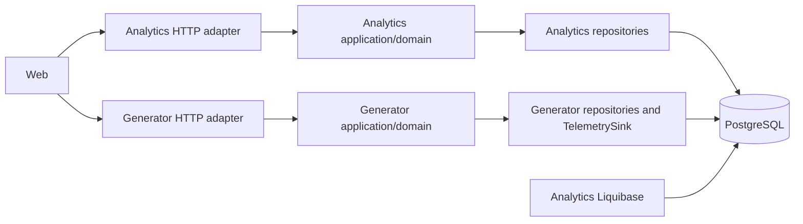

# Architecture Spine — FKIT BI data path

## Design Paradigm

Каждое Spring-приложение использует Ports and Adapters: domain/application не зависит от JDBC и HTTP. Общая PostgreSQL является интеграционной границей с единственным DDL-владельцем; готовые аналитические проекции отделяют горячую запись raw от frontend-чтения.



## Invariants & Rules

### AD-1 — [ADOPTED] Одна PostgreSQL с логическими schemas

- **Binds:** Все хранимые домены MVP.
- **Prevents:** Отдельные модули создают конфликтующие таблицы в `public` или преждевременно требуют распределённых транзакций.
- **Rule:** Доменные таблицы располагаются только в `equipment`, `telemetry`, `analytics`, `incident` или `generator`; MVP использует одну физическую PostgreSQL.

### AD-2 — [ADOPTED] Единственный владелец DDL

- **Binds:** Liquibase и запуск Analytics/Generator.
- **Prevents:** Конкурирующие миграции и запуск Generator против неполной схемы.
- **Rule:** Только Analytics применяет Liquibase при startup через отдельные `spring.liquibase` owner credentials; его readiness остаётся false до успеха, а Generator стартует после Analytics readiness. Основной Analytics datasource использует runtime credentials. Оба приложения дополнительно проверяют точное поддерживаемое значение `equipment.schema_release`; переход Flyway → Liquibase, разделение credentials и startup dependency реализуются одним implementation slice.

### AD-3 — [ADOPTED] Владение данными по модулям

- **Binds:** Equipment, telemetry, projections, incidents и generator state.
- **Prevents:** Два сервиса независимо изменяют одну бизнес-сущность.
- **Rule:** Analytics изменяет `equipment`, `analytics` и `incident`; Generator изменяет `generator` и только добавляет rows через telemetry append contract; междоменные исключения фиксируются grants и интеграционными тестами.

### AD-4 — [ADOPTED] Нормализованное ядро оборудования

- **Binds:** Enterprise, ProductionLine, Machine, Component, TelemetrySignal, Shift и справочники.
- **Prevents:** Дублирование владельцев и противоречивые межпредметные ссылки.
- **Rule:** Владение моделируется FK и составными FK на границах Enterprise/Machine; расширяемые semantic/unit codes являются справочниками; JSONB разрешён только для валидированных display parameters, которые не участвуют в фильтрах и расчётах. Component tree mutations сериализуются lock владельца Machine, Shift schedule mutations — lock Enterprise, а первое использование Signal и изменение его семантики используют shared/exclusive transaction advisory locks, производные от `signal_id`. Возможная коллизия ключа только избыточно сериализует разные Signal и не нарушает целостность.

### AD-5 — [ADOPTED] Append-only raw hot path

- **Binds:** `telemetry.ingest_batch` и `telemetry.raw_measurement`.
- **Prevents:** FK/UPSERT/index amplification блокирует или замедляет ingestion.
- **Rule:** Raw measurement не обновляется, не имеет per-row FK или unique и содержит ровно одно типизированное значение; валидность Signal проверяется до транзакции по snapshot/cache. Транзакция raw также фиксирует durable `signal_usage` при первом use и per-machine `recalculation_hint`; оба служебных набора переживают удаление raw.

### AD-6 — [ADOPTED] Идемпотентность на уровне batch

- **Binds:** TelemetrySink retry и historical checkpoints.
- **Prevents:** Неопределённый результат commit создаёт повторные measurements.
- **Rule:** Пакет из 1..1000 rows фиксируется одной короткой транзакцией; `(producer_id, producer_batch_id)` уникален и связан с SHA-256 точного versioned binary encoding `TELEMETRY_BATCH_V1`. Равный hash означает idempotent success, несовпадающий — `BATCH_ID_REUSED_WITH_DIFFERENT_PAYLOAD`.

### AD-7 — [ADOPTED] Event-time partitioning и retention

- **Binds:** Raw storage lifecycle.
- **Prevents:** Построчная очистка и неограниченный рост горячей таблицы.
- **Rule:** `raw_measurement` разделяется на UTC-day RANGE partitions по `observed_at`, без default partition, с локальным индексом `(signal_id, observed_at)`; raw retention составляет 90 суток по времени PostgreSQL. Historical принимает только этот active window. Registry UTC-day partitions и его row locks исключают гонку retention с созданием raw/recalculation work; detach разрешён только после перевода дня в `RETIRING` и проверки отсутствия unconsumed hints, пересекающих jobs/leases и неполностью опубликованных проекций.

### AD-8 — [ADOPTED] Независимые write, calculation и read paths

- **Binds:** Ingestion, workers и Analytics read API.
- **Prevents:** Frontend ждёт вставку или перерасчёт, а worker блокирует raw writer.
- **Rule:** Ingestion только добавляет raw; workers читают committed raw без row locks и публикуют новые проекции отдельной короткой транзакцией; API читает только последнюю committed projection и её freshness metadata.

### AD-9 — [ADOPTED] Ограниченный ресурсный профиль

- **Binds:** Pools, batches, worker concurrency и benchmark.
- **Prevents:** Historical generation вытесняет realtime и query workload на минимальном стенде.
- **Rule:** Базовый профиль — 30 measurements/s, benchmark — 200/s на 30 минут, 1000/s на 60 секунд и 1000–2000/s throttled historical; Analytics использует один pool до 14–16 connections и semaphore limits, не позволяющие workers занять весь pool, Generator — 2–3 connections, batch — не более 1000 rows. Historical проходит storage preflight и останавливается при disk pressure.

### AD-10 — [ADOPTED] Partition DDL вне горячей транзакции

- **Binds:** Создание и удаление partitions.
- **Prevents:** Insert ждёт DDL-lock или создаёт таблицу на demand.
- **Rule:** Liquibase устанавливает owner-owned `SECURITY DEFINER` routines с fixed `search_path`, validated date и единым topology advisory lock. Analytics заранее поддерживает диапазон raw window плюс 7 future days; и create, и обычный detach используют короткие lock/statement timeouts и retry. DDL никогда не выполняется внутри TelemetrySink transaction; `DETACH CONCURRENTLY` отложен.

### AD-11 — [ADOPTED] Раздельные database roles

- **Binds:** Liquibase, runtime services и monitoring.
- **Prevents:** Generator получает DDL или произвольную запись в чужие schemas.
- **Rule:** `fkit_bi_owner`, `fkit_bi_analytics`, `fkit_bi_generator` и `fkit_bi_monitor` имеют отдельные credentials и минимальные grants. Analytics использует owner только встроенным Liquibase на startup, основной datasource — только runtime role; Generator не получает DDL или telemetry UPDATE/DELETE.

### AD-12 — [ADOPTED] Единое физическое кодирование telemetry

- **Binds:** Generator writer, Analytics reader и SQL CHECK constraints.
- **Prevents:** Сервисы по-разному интерпретируют одинаковые `SMALLINT` и flag bits.
- **Rule:** Batch mode: `1=REALTIME`, `2=HISTORICAL`; source quality: `0=GOOD`, `1=UNCERTAIN`, `2=BAD`; validation flags: `1=OUT_OF_RANGE`, `2=CLOCK_SKEW`. Quality не дублируется в flags; producer IDs ограничены 128 символами, `value_text` — 500.

## Consistency Conventions

| Concern | Convention |
| --- | --- |
| Naming | SQL `snake_case`; stable API codes; UTC-day partition name `raw_measurement_YYYYMMDD` |
| Data & formats | UUID назначает backend; event/audit time — `TIMESTAMPTZ(3)`; local Shift time — `TIME(0)` + `DATE` |
| Mutation | Конфигурация — транзакционный CRUD без physical delete; raw — append-only; projections — replace/publish |
| Migration | Explicit Liquibase includes; YAML orchestration + formatted SQL; applied changesets immutable |
| Availability | Bounded retry/buffers; telemetry loss допустима и наблюдаема; query path сохраняет connection reserve |

## Stack

| Name | Version |
| --- | --- |
| Java | 21 |
| Spring Boot | 3.5.16 |
| Liquibase Community | 4.31.1 (Spring Boot 3.5.16 managed) |
| PostgreSQL | 16 |
| PostgreSQL JDBC | 42.7.11 (Spring Boot 3.5.16 managed) |

## Structural Seed

```text
fkit-bi-analytics/src/main/resources/db/changelog/
  db.changelog-master.yaml
  releases/
    001-foundation/
    002-equipment/
    003-telemetry/
    004-analytics/
    005-incidents/
    006-generator/
```

## Capability → Architecture Map

| Capability / Area | Lives in | Governed by |
| --- | --- | --- |
| Конфигурация оборудования | Analytics equipment module + `equipment` | AD-1, AD-3, AD-4 |
| Liquibase bootstrap | Analytics migration adapter | AD-2, AD-10, AD-11 |
| Realtime/historical ingestion | Generator TelemetrySink + `telemetry` | AD-5, AD-6, AD-7, AD-9, AD-12 |
| Расчёт проекций | Analytics calculation workers + `analytics` | AD-8, AD-9 |
| Frontend read API | Analytics query module | AD-8 |
| Retention | Analytics maintenance worker | AD-7, AD-10, AD-11 |

## Deferred

- Механизм будущего физического разделения БД — возвращаться только при выделении ingestion/calculation в отдельный deployment.
- Kafka/ETL adapter — возвращаться при появлении внешних производителей или требовании durable buffering вне PostgreSQL.
- Набор дополнительных raw indexes — добавлять только после зафиксированного slow query и `EXPLAIN (ANALYZE, BUFFERS)`.
- Масштабирование более одного экземпляра Analytics — детализировать перед horizontal deployment; MVP использует один экземпляр.
- `DETACH PARTITION CONCURRENTLY` и отдельный maintenance process — возвращаться только если короткий ordinary detach с timeout не проходит benchmark.
- Отдельные datasource pools по workload class — вводить только если один pool с semaphore limits не сохраняет query SLO.
