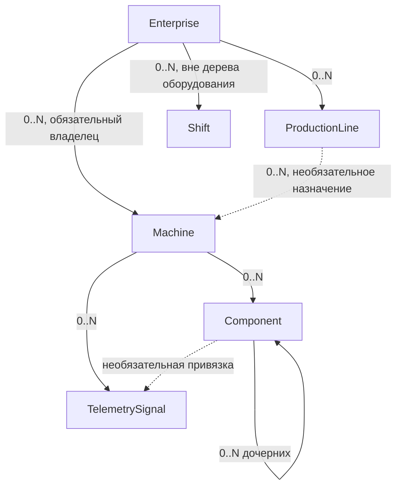

# Модель иерархии оборудования

## Структура

| Родитель | Дочерняя сущность | Правило дочерней сущности |
| --- | --- | --- |
| `Enterprise` | `ProductionLine` | Ровно один обязательный `enterpriseId` |
| `Enterprise` | `Shift` | Ровно один обязательный `enterpriseId`; Shift не является оборудованием |
| `Enterprise` | `Machine` | Ровно один обязательный неизменяемый `enterpriseId` |
| `ProductionLine` | `Machine` | Необязательный `lineId`; допустим один переход из `null` в Line того же Enterprise |
| `Machine` | `Component` | Ровно один обязательный `machineId` |
| `Component` | `Component` | Необязательный `parentComponentId`; родитель принадлежит той же машине |
| `Machine` | `TelemetrySignal` | Ровно один обязательный `machineId` |
| `Component` | `TelemetrySignal` | Необязательный `componentId`; компонент принадлежит той же машине, что и сигнал |

Свободная машина может получать компоненты, сигналы и правила, но до назначения линии не участвует в генерации, приёме производственной телеметрии и аналитике. Несколько свободных машин назначаются линии атомарно; конфликт одной машины отменяет весь пакет. После назначения машину нельзя перенести или снять с линии в MVP.

## Структурные поля Component

| Поле | Правило MVP |
| --- | --- |
| `id` | Неизменяемый UUID |
| `machineId` | Обязательный и неизменяемый владелец |
| `parentComponentId` | Необязательный; изменяется только внутри той же машины |
| `code` | Неизменяемый, уникальный внутри машины |
| `name` | Изменяемое отображаемое название |
| `kind` | Одно значение `ComponentKind` |
| `sortOrder` | Неотрицательное целое; сортировка среди siblings сначала по нему, затем по `code`; одинаковые значения допустимы |
| `status` | Собственный `ACTIVE` или `DISABLED` |
| `parameters` | До 100 встроенных типизированных display-параметров по общей модели конфигурации |

Корневой компонент имеет `parentComponentId = null`. Машина может иметь несколько корневых компонентов. Логически глубина дерева не ограничена фиксированным числом, но каждое сохранённое дерево конечно.

## Каталог ComponentKind

Каталог описывает доминирующую роль компонента. Он не создаёт отдельные таблицы и сам по себе не включает специальную расчётную логику. Более точные характеристики задаются названием и параметрами. Начальный каталог является закрытым для входного API; `OTHER` позволяет сохранить неизвестный тип до планового расширения контракта.

| Группа | Значения | Назначение и примеры |
| --- | --- | --- |
| Структура | `LOGICAL_GROUP`, `ASSEMBLY`, `MODULE`, `MECHANISM` | Логическая группа, сборка, модуль или общий механизм |
| Движение и передача | `MOTOR`, `DRIVE`, `GEARBOX`, `SPINDLE`, `BEARING`, `COUPLING`, `ACTUATOR` | Электродвигатель, привод, редуктор, шпиндель, подшипник, муфта, исполнительный механизм |
| Технологический процесс | `PUMP`, `COMPRESSOR`, `FAN`, `BLOWER`, `VALVE`, `HEATER`, `COOLER`, `MIXER`, `DOSER` | Перекачивание, сжатие, вентиляция, регулирование, нагрев, охлаждение, смешивание, дозирование |
| Перемещение материала | `CONVEYOR`, `FEEDER`, `ROBOT`, `MANIPULATOR` | Конвейер, податчик, робот или манипулятор |
| Оснастка | `TOOL`, `FIXTURE` | Инструмент и технологическая оснастка |
| Измерение и управление | `SENSOR`, `INSTRUMENT`, `CONTROLLER`, `SAFETY_DEVICE` | Датчик, измерительный прибор, контроллер или защитное устройство |
| Обеспечивающие системы | `POWER_SUPPLY`, `LUBRICATION_SYSTEM`, `HYDRAULIC_SYSTEM`, `PNEUMATIC_SYSTEM`, `COOLING_SYSTEM` | Питание, смазка, гидравлика, пневматика или охлаждение |
| Расширение | `OTHER` | Вид пока отсутствует в каталоге; точное назначение указывается в `name` и параметрах |

Добавление нового значения каталога не меняет идентичность существующих компонентов. Изменение `kind` не должно подменять физический объект другим объектом: если меняется смысл узла, создаётся новый `Component`, а прежний переводится в `DISABLED`.

## Владение TelemetrySignal

- `machineId` обязателен и не изменяется после создания.
- `componentId = null` означает сигнал уровня машины.
- Ненулевой `componentId` должен принадлежать той же `machineId`.
- Один компонент может иметь любое число сигналов, включая ноль.
- Один сигнал не может одновременно принадлежать нескольким компонентам.
- Перепривязка сигнала внутри той же машины допустима только как исправление структуры без изменения физического смысла сигнала; правила изменения сигнала после появления raw data уточняются в signal-spec.

## Инварианты дерева

- `parentComponentId` не может совпадать с `id` компонента.
- Цепочка родителей не может возвращаться к уже посещённому компоненту.
- Изменение `parentComponentId` и проверка отсутствия цикла выполняются атомарно.
- Компонент нельзя переместить в другую машину; создаётся новый компонент, а прежний отключается.
- Изменение родителя не переписывает телеметрию и аналитические результаты.
- Из-за отсутствия версий конфигурации исторические экраны используют текущее положение компонента в дереве.
- Перевод Component в `DISABLED` не меняет status потомков или TelemetrySignals и не создаёт `effectiveStatus`; readiness и новый generator run отдельно сообщают о disabled required component.
