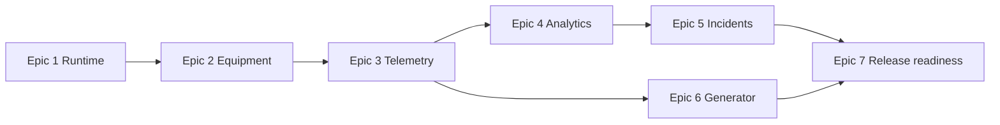

# MVP implementation roadmap

Work is grouped by end-to-end user value. Stories are outcomes with a measurable boundary, not a task checklist; split them further during sprint planning if they do not fit a delivery slice. Analytics and Generator remain separate deployables, while each service is internally modular.

## Epic 1 — Secure and reproducible runtime foundation

**Owning repos:** `fkit-bi-infra` (runtime/proxy/observability), `fkit-bi-analytics` (auth/migrations), `fkit-bi-generator` (JWT validation/readiness).

**Outcome:** operator can start the demo stack, authenticate, and observe its health.

- **1.1 Application foundations:** establish Java/Spring module/package boundaries, JDBC access, configuration profiles, health/readiness, error envelope and trace ID behavior. Verify build and CI from clean checkout.
- **1.2 PostgreSQL migration ownership:** remove Flyway bootstrap dependency where specified, add Analytics-owned Liquibase schemas/catalogs/release marker, protect old dev marker metadata, and make Generator readiness depend on supported schema release. Verify clean and existing-dev DB Testcontainers cases.
- **1.3 Authentication:** bootstrap operator setup/login, password hashing, JWT issue/validation, create-user form/API, shared bearer validation in both services. Verify auth API contract and denied protected requests.
- **1.4 Local/prod edge and observability:** Compose, Nginx routes for `bi.kitexp.ru` and `*.bi.kitexp.ru`, Certbot and self-signed modes, Prometheus/Grafana/exporters, provisioned dashboards, JSON logs and safe trace propagation. Verify startup without observability dependency and TLS modes.
- **1.5 Backup/restore operations:** scheduled dump, permissions, age monitoring, retention/partition operation runbook and isolated restore drill. Do not implement PITR/HA.

## Epic 2 — Configure enterprise, shifts and equipment

**Owning repo:** `fkit-bi-analytics`; frontend consumes the contract from `fkit-bi-web`.

**Outcome:** authenticated user builds the hierarchy that enables telemetry and generation.

- **2.1 Enterprise and shift calendar:** create/update/disable Enterprise and shifts, validate timezone and local day/night intervals including cross-midnight/DST policy, and supply enterprise-defined `shiftId` to operations.
- **2.2 Lines and machine assignment:** CRUD lines and machines; create machines assigned or unassigned; atomically batch-assign only eligible free machines to same-enterprise lines; order lines; enforce ACTIVE/DISABLED and ownership invariants.
- **2.3 Component and signal configuration:** manage machine-owned component tree and signal catalog, enforce same-machine references, stable codes, type/unit semantics, and immutable signal identity after raw usage.
- **2.4 Machine state configuration:** validate typed declarations, comparison operators/tolerances, priority, delays, hysteresis, default state and readiness; expose rule validation feedback.
- **2.5 Configuration journey:** compose required calls with bounded requests, error recovery and selectors as described by frontend flows; verify AC-1 end-to-end.

## Epic 3 — Reliable raw telemetry and realtime state

**Owning repos:** Analytics owns schema/projections; Generator owns the writer and execution. Raw data/table contract is shared and versioned by Analytics.

**Outcome:** valid realtime measurements persist quickly and yield a current machine/signal read model.

- **3.1 Raw schema and partition lifecycle:** batch header/hash, typed append-only measurements, UTC partitioning, retention metadata, indexes and signal usage constraints.
- **3.2 Telemetry writer:** JDBC batch writer with short atomic transactions, producer/batch idempotency, event/receive timestamps, skew and quality validation; finite bounded retry/drop behavior and metrics.
- **3.3 Ingestion-to-work handoff:** persist durable dirty hints atomically with accepted batch and implement ordered discovery/checkpoint/leases without per-measurement jobs.
- **3.4 Signal current projection:** calculate usable/latest received values, freshness/quality and currency; expose frontend read response without scanning raw history.
- **3.5 State evaluation and deadlines:** implement pure evaluator, state intervals/current projection, one nearest deadline per machine and delayed worker with `SKIP LOCKED`; verify event vs detection time.
- **3.6 Realtime golden slice:** run generator against configured equipment, ingest samples, calculate status and fetch current reads; verify AC-2 and AC-8.

## Epic 4 — Historical projections and query API

**Owning repo:** `fkit-bi-analytics`.

**Outcome:** frontend reads bounded history, shift views and production metrics from prepared projections.

- **4.1 Calculation queue and publication:** merge dirty windows, restore prior evaluator context, stage outside transaction and atomically replace ranges/current state/checkpoints.
- **4.2 Minute rollups:** persist additive state durations, production counts, scrap, transition/failure counts, numeric aggregates and loss buckets; use replacement semantics.
- **4.3 Metric calculator:** compute availability/performance/quality/OEE/MTBF/MTTR from totals with null/unit compatibility semantics.
- **4.4 Current and overview reads:** bounded queries for enterprise/line/machine and shift summaries, including `dataThrough`, stale/recalculating and empty/partial status.
- **4.5 Historical series/Pareto/chronometry:** execute limited, aligned interval reads with `shiftId`, buckets, units, coverage and truncation metadata; no raw query for metric calculations.
- **4.6 Explicit replay jobs:** PERIOD/ALL job lifecycle, range validation, progress/status, current-rule replay and safe repeated publication.
- **4.7 Late-data acceptance:** inject late and historical batches; verify AC-3/4/5/7 and concurrent old-or-new reads.

## Epic 5 — Manual incidents and loss attribution

**Owning repo:** `fkit-bi-analytics`.

**Outcome:** user records operational context and sees it in refreshed analysis without altering raw data.

- **5.1 Loss reason catalog:** enterprise-scoped reasons/category, code uniqueness and disabled selection behavior.
- **5.2 Manual incident lifecycle:** create/update/close/cancel, idempotency, ownership, overlap and eligible-state validation; atomically persist recalculation work.
- **5.3 Loss projections and UI reads:** deterministic attribution to effective eligible states and fast reason Pareto; update projections atomically and expose job freshness.
- **5.4 Incident golden tests:** verify incident behavior and AC-6, including lost-response retry.

## Epic 6 — Generator configuration and run control

**Owning repo:** `fkit-bi-generator`; equipment lookup and telemetry schema contract are owned by Analytics.

**Outcome:** user configures one reusable scenario and starts/stops/retries real-time, historical or future runs.

- **6.1 Scenario API and storage:** scenario CRUD/validation, behavior model type validation, machine/signal readiness, ordered phases and enabled status.
- **6.2 Immutable run snapshot:** expand effective behavior matrix, resolve current equipment/signal metadata and seed at acceptance; snapshot remains stable after edits.
- **6.3 Realtime execution:** durable run state, machine reservations, tick scheduler, bounded batch writer, no overdue catch-up burst, progress/status/stop/retry.
- **6.4 Historical and scheduled execution:** virtual clock and 5-minute checkpoint chunks; throttle shared historical capacity; exact UTC future start and 30-second misfire behavior.
- **6.5 Generator acceptance:** all 12 public operations covered, golden deterministic data, reservation races and AC-8/9 verified.

## Epic 7 — Security, performance and demo readiness

**Owning repos:** all four repositories; `fkit-bi-infra` owns integrated Compose/deployment and benchmark evidence.

**Outcome:** complete MVP can be demonstrated under the agreed workload and recovered after defined failures.

- **7.1 Contract and regression CI:** lint all OpenAPI contracts, operation inventory test, generated client compatibility, migrations and golden acceptance suite.
- **7.2 Performance benchmark:** run full 4 vCPU/8 GB load profile (nominal, sustained, burst, concurrent reads, 20M historical) and record evidence against existing SLOs.
- **7.3 Failure/recovery verification:** worker restarts, lease recovery, batch duplicate/lost ack, staging crash, run retry, observability stop and DB backup restore.
- **7.4 Demo rehearsal:** execute the accepted end-to-end demo from clean environment with JWT, configured plant, realtime run, analytics reads, incident/recalculation, scheduled run and dashboards.

## Dependencies and order

Epic 6 can develop alongside Epic 4 once telemetry contract and equipment readiness are stable; its integration acceptance needs Epic 3. Epic 7 begins its CI/regression work early, but final benchmark, restore drill, and demo rehearsal require the integrated stack.

## Explicit MVP debt / exclusions

- No role/permission matrix beyond bootstrap user creation; all authenticated users share business access.
- No machine configuration version history, equipment transfer history, or historical hierarchy reconstruction.
- No automatic incident detection/classification or full audit ledger.
- No separate raw/aggregate database, Kafka, external broker, ETL service, or multi-region/high-availability design.
- No recurring Generator schedules, physical-fidelity calibration, cross-signal physical model, or behavior correction editor beyond declared MVP model types.
- No raw-data query fallback for analytics and no strict exactly-once guarantee across external effects; use durable at-least-once work plus idempotent replacement.
- Local backup does not survive host loss; off-host backup copy and DNS routing are operator deployment responsibilities.
- Numeric SLO/load outcomes, query plans and batch parameters must be confirmed by the specified benchmark, not assumed from the written target.
